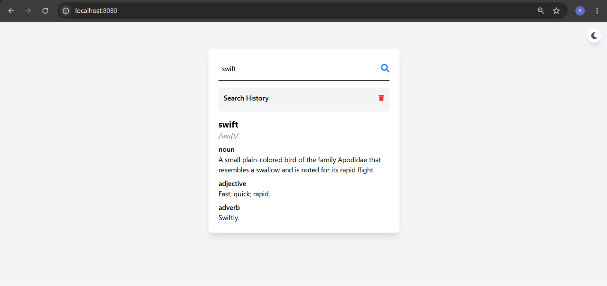
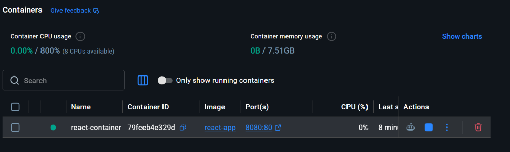
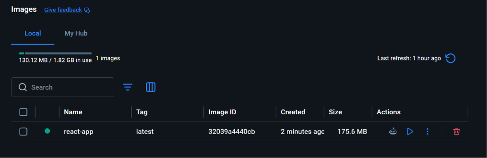
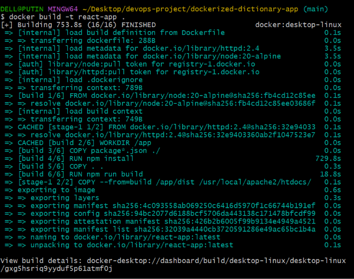
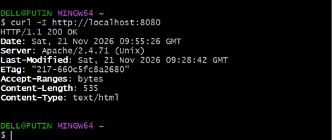

# Dockerizing a React Application

## Project Overview

This project demonstrates how to containerize a React application using Docker and deploy it using a multi-stage Docker build.

The application is built using Node.js and served using the Apache HTTP Server (`httpd:2.4`).

The goal of this project is to understand Docker fundamentals, including writing a Dockerfile, building Docker images, running containers, mapping ports, and inspecting container logs.

## Technologies Used

- React
- Node.js 20 (Alpine)
- Docker
- Apache HTTP Server (httpd:2.4)

## Project Structure

```text
project/
│
├── src/
├── public/
├── package.json
├── package-lock.json
├── Dockerfile
├── .dockerignore
└── README.md
```

## Dockerfile

This project uses a multi-stage Docker build to separate the application build environment from the production environment.

```dockerfile
# Build stage
FROM node:20-alpine AS build

WORKDIR /app

COPY package*.json ./

RUN npm ci

COPY . .

RUN npm run build

# Production stage
FROM httpd:2.4

COPY --from=build /app/dist /usr/local/apache2/htdocs/

EXPOSE 80
```

### Dockerfile Explanation

| Instruction | Description |
|---|---|
| `FROM node:20-alpine AS build` | Uses Node.js 20 Alpine as the build environment. |
| `WORKDIR /app` | Sets the working directory inside the container. |
| `COPY package*.json ./` | Copies package.json and package-lock.json. |
| `RUN npm ci` | Installs dependencies from the lock file. |
| `COPY . .` | Copies the application source code. |
| `RUN npm run build` | Builds the React application. |
| `FROM httpd:2.4` | Creates the production stage using Apache HTTP Server. |
| `COPY --from=build ...` | Copies the generated production files into Apache's document root. |
| `EXPOSE 80` | Documents the port used by the application inside the container. |

## Building the Docker Image

To build the Docker image from the Dockerfile in the current working directory:

```bash
docker build -t react-app .
```

- `docker build`: Builds a Docker image.
- `-t react-app`: Assigns the image the name `react-app`.
- `.`: Specifies the current working directory as the build context.

## Listing Docker Images

To display the Docker images available locally:

```bash
docker images
```

## Running the Container

To create and run a container from the `react-app` image:

```bash
docker run -d -p 8080:80 --name react-container react-app
```

Command breakdown:

- `docker run`: Creates and starts a container.
- `-d`: Runs the container in detached mode (background).
- `-p 8080:80`: Maps port 8080 on the host machine to port 80 inside the container.
- `--name react-container`: Assigns a name to the container.
- `react-app`: Specifies the Docker image to use.

## Listing Running Containers

To view currently running containers:

```bash
docker ps
```

To view all containers, including stopped containers:

```bash
docker ps -a
```

## Accessing the Application

After starting the container, open the following URL in your browser:

```text
http://localhost:8080
```

To verify that the application is responding successfully, run:

```bash
curl -I http://localhost:8080
```

A successful response should return an HTTP status such as:

```text
HTTP/1.1 200 OK
```

## Checking Container Logs

To inspect the logs generated by the container:

```bash
docker logs react-container
```

To continuously monitor new log entries:

```bash
docker logs -f react-container
```

## Screenshots

The following screenshots demonstrate the Docker build and deployment process.

### 1. Running React Application

Shows the React application successfully served through Docker.


### 2. Running Docker Container

Shows the running container in Docker Desktop, including its image name and port mapping.


### 3. Docker Image

Screenshot of the successfully built Docker image.


### 4. Docker Build Process

Screenshot showing the successful execution of the Docker build command.


### 5. HTTP Response Verification

Screenshot showing the successful HTTP response using `curl -I http://localhost:8080`.


## Key Learnings

Through this project, I gained practical experience with:

- Writing and understanding Dockerfiles.
- Using multi-stage Docker builds.
- Building Docker images.
- Creating and managing Docker containers.
- Mapping container ports to host ports.
- Serving a React production build using Apache HTTP Server.
- Inspecting container status and logs.
- Verifying application availability through HTTP requests.

## Conclusion

This project provided hands-on experience with containerizing a frontend application and deploying it using Docker.

Using a multi-stage build helped separate the development/build environment from the production environment, allowing the final application to be served using Apache HTTP Server.

